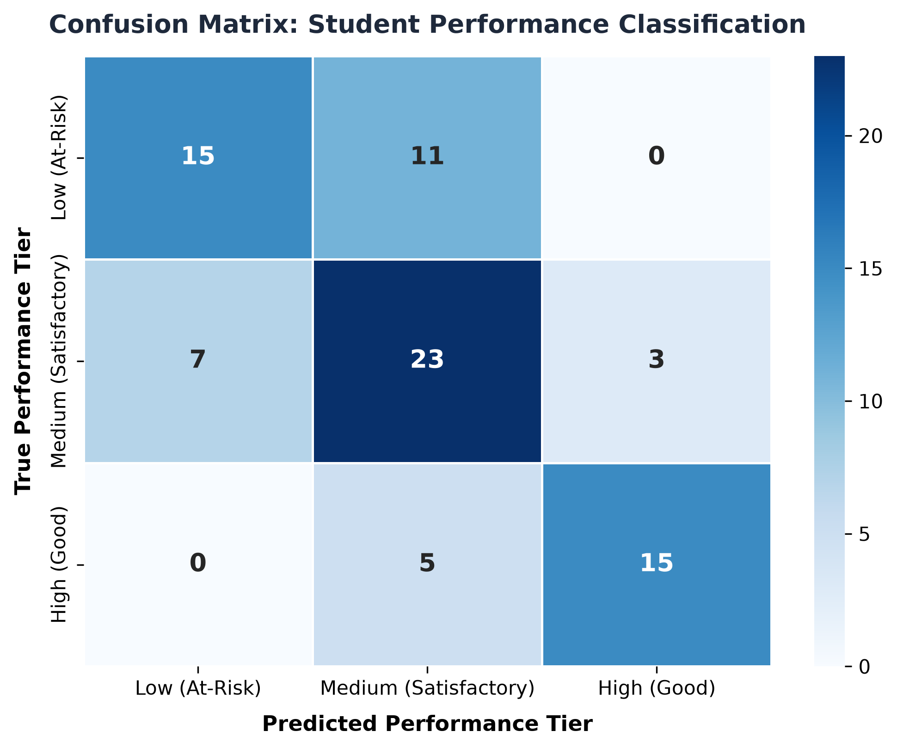
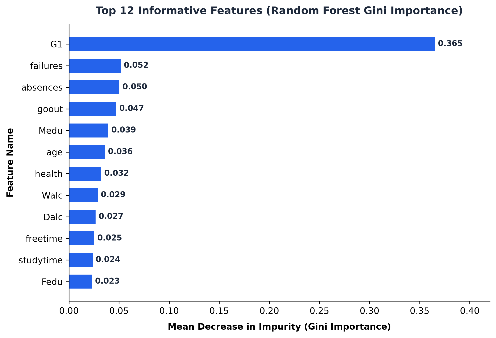
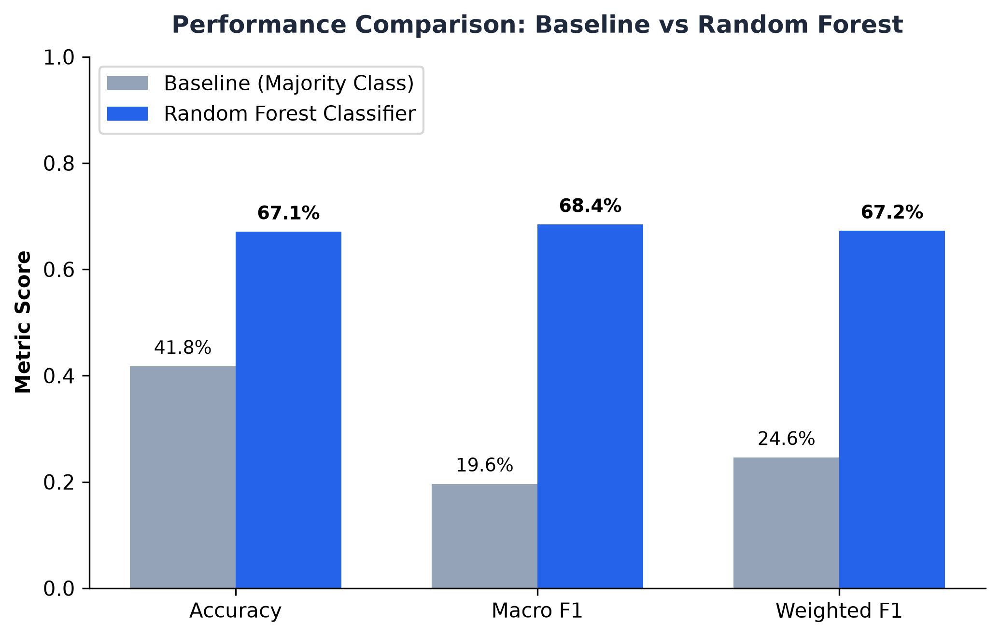

# Student Performance Prediction Using Machine Learning
> **Course:** Fundamentals of Artificial Intelligence  
> **Algorithm:** Random Forest Classifier  
> **Application:** Educational Data Mining & Early Academic Intervention  
> **Framework:** Python, Scikit-learn, Streamlit, Joblib  

[](https://www.python.org/)
[](https://creativecommons.org/licenses/by/4.0/)
[](https://streamlit.io/)
[](https://scikit-learn.org/)
[-brightgreen.svg)]()

---

## 📌 1. Project Overview

Academic failure and course attrition represent severe challenges in secondary and higher education worldwide. Traditional institutional evaluation systems are predominantly **retrospective**: students who struggle or fail are identified only after summative final examinations have taken place, at which point remedial support can no longer salvage the academic term.

**EduPredict AI** is a complete, production-ready machine learning framework and analytical web application designed for **early educational intervention**. Leveraging an optimized **Random Forest Classifier** trained on the benchmark UCI Student Performance dataset (Cortez & Silva, 2008), the system predicts a student's terminal academic performance category early in the semester using Period 1 diagnostic assessments alongside multidimensional behavioral, attendance, familial, and lifestyle indicators.

Crucially, this project enforces an airtight **Data Leakage Prevention Protocol**:
- The target variable is derived strictly from the final examination score ($G3$).
- Both $G3$ and the second-period examination score ($G2$, correlation $r = 0.904$ with $G3$) are **strictly excluded** from the predictor feature matrix.
- The model relies only on diagnostic Period 1 checkpoints ($G1$) and background factors, guaranteeing that predictions represent a genuine, actionable early-warning window for educators.

---

## 🎯 2. Problem Statement

Educational institutions collect information regarding students' attendance, study habits, prior academic history, and assessment scores. Understanding patterns across these heterogeneous factors is essential for proactively identifying learners who would benefit from extra academic mentoring.

The objective is to train a supervised machine learning classifier $f(X) \rightarrow Y$ that maps a 24-dimensional feature vector $X$ to one of three standardized academic performance tiers:
1. **`Low (At-Risk)`**: Final grade $G3 < 10$ out of 20 (official course failure threshold).
2. **`Medium (Satisfactory)`**: Final grade $10 \le G3 < 14$ (sufficient core competency).
3. **`High (Good / Distinction)`**: Final grade $14 \le G3 \le 20$ (academic excellence).

---

## 🚀 3. Key Features

- **Ensemble Random Forest Engine**: 100 de-correlated decision trees with Gini impurity splitting, variance reduction through bootstrap aggregation, and random feature subspace sampling.
- **Leak-Free Preprocessing Pipeline**: Scikit-learn `ColumnTransformer` with `SimpleImputer` (median/mode), `StandardScaler`, and `OneHotEncoder(drop='first', handle_unknown='ignore')`.
- **Zero-Retraining Web Dashboard**: Streamlit front-end with `@st.cache_resource` loading the serialized Joblib model for sub-10ms real-time inference.
- **Evidence-Based Recommendations**: Automatically analyzes student risk factors (e.g., absenteeism, low study hours, prerequisite failures) to generate actionable pedagogical advice for instructors.
- **Calibrated Class Probabilities**: Outputs confidence distributions across all three tiers rather than opaque single-label outputs.
- **Comprehensive Deliverables**: Includes an automated 12-test unit test suite, a verified **10-page academic report** (PDF & DOCX), a **12-slide PowerPoint presentation** (PPTX with speaker notes), and a video demonstration script.

---

## 🛠️ 4. Technology Stack

| Layer | Technologies |
| :--- | :--- |
| **Programming Language** | Python 3.10+ (tested on Python 3.13) |
| **Machine Learning** | Scikit-learn, NumPy, Joblib |
| **Data Manipulation** | Pandas |
| **Web Dashboard** | Streamlit |
| **Data Visualization** | Matplotlib, Seaborn |
| **Document Generation** | ReportLab (PDF), python-docx (DOCX), python-pptx (PPTX) |
| **Automated Testing** | Pytest |
| **Notebook Analysis** | Jupyter (nbformat) |

---

## 📊 5. Dataset Attribution & License

- **Source:** [UCI Machine Learning Repository: Student Performance Data Set](https://archive.ics.uci.edu/dataset/320/student+performance)
- **Creators:** Paulo Cortez and Alice Silva (University of Minho, Portugal, 2008)
- **License:** Creative Commons Attribution 4.0 International (CC BY 4.0)
- **Records:** 395 secondary school students in Mathematics (`student-mat.csv`)
- **Features Used:** 24 input features (14 numerical, 10 categorical), zero data leakage.

For full codebook and attribute documentation, see [data/README.md](data/README.md).

---

## 🏗️ 6. System Architecture

```
                    Raw Data (UCI Repository: N=395)
                                  │
                                  ▼
      ┌────────────────────────────────────────────────────────┐
      │               Target Derivation & Leakage Check        │
      │  - Derive Target: Low (<10), Med (10-13), High (14-20) │
      │  - Strictly Exclude G3 (target) and G2 (leakage)       │
      └────────────────────────────────────────────────────────┘
                                  │
                                  ▼
      ┌────────────────────────────────────────────────────────┐
      │         Stratified Train / Test Split (80% / 20%)      │
      │         - Train: 316 samples  |  Test: 79 samples      │
      └────────────────────────────────────────────────────────┘
                                  │
                                  ▼
      ┌────────────────────────────────────────────────────────┐
      │          ColumnTransformer Preprocessing Pipeline      │
      │  - Numerical: Median Imputer + StandardScaler (14 cols)│
      │  - Categorical: Mode Imputer + OneHotEncoder (10 cols) │
      └────────────────────────────────────────────────────────┘
                                  │
                                  ▼
      ┌────────────────────────────────────────────────────────┐
      │               Random Forest Classifier                 │
      │  - 100 Trees  |  Max Depth: 6  |  Min Split: 4         │
      │  - Criterion: Gini Impurity    |  Parallel: n_jobs=-1  │
      └────────────────────────────────────────────────────────┘
                                  │
                                  ▼
      ┌────────────────────────────────────────────────────────┐
      │               Production Inference & UI                │
      │  - Serialized Pipeline: models/student_rf_pipeline.joblib│
      │  - Streamlit Dashboard: app.py (5 Analytical Pages)    │
      │  - Actionable Pedagogical Intervention Guidance        │
      └────────────────────────────────────────────────────────┘
```

---

## 📁 7. Repository Folder Structure

```
student-performance-prediction/
│
├── app.py                          # Streamlit analytical web dashboard
├── train_model.py                  # CLI training, evaluation, and chart generation script
├── generate_reports.py             # Academic PDF & DOCX report generation script
├── requirements.txt                # Production dependency specifications
├── README.md                       # Comprehensive project documentation
├── .gitignore                      # Git exclusion rules
│
├── .streamlit/
│   └── config.toml                 # Streamlit server and theme configuration
│
├── data/
│   ├── README.md                   # Dataset acquisition guide and codebook
│   ├── student-mat.csv             # Primary Mathematics cohort (N=395)
│   ├── student-por.csv             # Portuguese language cohort (N=649)
│   ├── student.txt                 # Author dataset description
│   └── student-merge.R             # Cohort merge utility
│
├── models/
│   ├── README.md                   # Model architecture, hyperparameters & usage
│   ├── student_rf_pipeline.joblib  # Serialized Scikit-learn Pipeline
│   ├── metrics.json                # Test evaluation metrics metadata
│   └── feature_importances.csv     # Ranked Gini feature importances
│
├── src/
│   ├── __init__.py                 # Package initializer
│   ├── data_preprocessing.py       # Cleaning, target derivation, ColumnTransformer
│   ├── model_training.py           # Pipeline construction & model fitting
│   ├── evaluation.py               # Metric calculation & figure plotting
│   └── prediction.py               # Inference engine, probability calibration & advice
│
├── notebooks/
│   └── exploratory_analysis.ipynb  # Interactive Jupyter notebook for EDA
│
├── tests/
│   ├── test_preprocessing.py       # Preprocessing & leakage isolation tests
│   └── test_prediction.py          # Model inference, validation & robustness tests
│
├── reports/
│   ├── student_performance_report.pdf   # Formal 10-page PDF report (Verified)
│   └── student_performance_report.docx  # Editable Microsoft Word report
│
├── presentation/
│   ├── student_performance_presentation.pptx # 12-slide presentation with speaker notes
│   └── presentation_script.md                # Slide-by-slide spoken script
│
├── assets/
│   └── charts/
│       ├── confusion_matrix.png     # Heatmap of test predictions
│       ├── feature_importance.png   # Top 12 Gini importances
│       ├── class_distribution.png   # Train vs Test stratification
│       ├── model_comparison.png     # Baseline vs Random Forest comparison
│       └── system_architecture.png  # High-resolution architectural diagram
│
└── demo/
    └── video_demo_script.md        # 2.5-minute video walkthrough script & recording checklist
```

---

## 💻 8. Installation & Setup Instructions

### Step 1: Clone the Repository
```bash
git clone https://github.com/your-username/student-performance-prediction.git
cd student-performance-prediction
```

### Step 2: Create and Activate a Virtual Environment
```bash
# On macOS / Linux:
python3 -m venv venv
source venv/bin/activate

# On Windows:
python -m venv venv
venv\Scripts\activate
```

### Step 3: Install Dependencies
```bash
pip install --upgrade pip
pip install -r requirements.txt
```

---

## 🏃 9. Running the Project

### Train and Evaluate the Model
To re-train the Random Forest classifier, evaluate on the test set, serialize the model, and regenerate all charts:
```bash
python train_model.py
```
*Output Summary:*
```
======================================================================
🎓 FUNDAMENTALS OF ARTIFICIAL INTELLIGENCE: PROJECT PIPELINE
Project: Student Performance Prediction Using Machine Learning
Algorithm: Random Forest Classifier
======================================================================
[1/5] Loading and preprocessing dataset from 'data/student-mat.csv'...
[2/5] Training Completed: 316 train, 79 test samples.
[3/5] Empirical Evaluation on Unseen Test Set (20%):
      Metric                    Baseline (Majority)    Random Forest  
      --------------------------------------------------------------
      Accuracy                  0.4177                 0.6709         
      Macro F1-Score            0.1964                 0.6845         
      Weighted F1-Score         0.2462                 0.6724         
      Macro Precision           0.1392                 0.7016         
      Macro Recall              0.3333                 0.6746         
✅ Model training and evaluation successfully executed!
```

### Launch the Streamlit Analytical Dashboard
```bash
streamlit run app.py
```
Open your browser to `http://localhost:8501`.

### Execute Automated Unit Tests
```bash
pytest tests/ -v
```
*Test Output: 12 tests passed (100% pass rate).*

### Regenerate Academic Reports (PDF & DOCX)
```bash
python generate_reports.py
```

---

## 📈 10. Empirical Model Evaluation

Evaluated on an unseen held-out test partition ($N = 79$ students, 20%):

| Metric | Majority Baseline (Zero-R) | Random Forest Classifier | Improvement |
| :--- | :--- | :--- | :--- |
| **Accuracy** | 0.4177 (41.77%) | **0.6709 (67.09%)** | **+25.32%** |
| **Macro F1-Score** | 0.1964 | **0.6845** | **+0.4881** |
| **Weighted F1-Score** | 0.2462 | **0.6724** | **+0.4262** |
| **Macro Precision** | 0.1392 | **0.7016** | **+0.5624** |
| **Macro Recall** | 0.3333 | **0.6746** | **+0.3413** |

### Per-Class Detailed Breakdown:
- **Low (At-Risk)**: Precision: `0.6818` | Recall: `0.5769` | F1-Score: `0.6250` (Support: 26)
- **Medium (Satisfactory)**: Precision: `0.5897` | Recall: `0.6970` | F1-Score: `0.6389` (Support: 33)
- **High (Good)**: Precision: `0.8261` | Recall: `0.7500` | F1-Score: `0.7895` (Support: 20)

### Top Predictive Features (Gini Importance):
1. **$G1$ (Period 1 Diagnostic Score)**: `36.5%` — Strongest individual baseline signal.
2. **`failures` (Past Course Failures)**: `5.2%` — Indicator of chronic prerequisite learning gaps.
3. **`absences` (School Absences)**: `5.0%` — Attendance regularity strongly modulates trajectory.
4. **`goout` (Going Out with Friends)**: `4.7%` — Social engagement balance.
5. **`Medu` (Mother's Education Level)**: `3.9%` — Socio-academic environmental support.
6. **`studytime` (Weekly Study Hours)**: `2.4%` — Structured independent study time.

---

## 🖼️ 11. Visualizations & Charts

All figures are automatically saved to `assets/charts/`:

| Confusion Matrix | Feature Importance | Model Comparison |
| :---: | :---: | :---: |
|  |  |  |

---

## 🔮 12. Example Predictions

### Example A: High Performing Student Profile
- **Inputs**: $G1 = 16.0$, Study Time = 3 (5–10 hrs/wk), Failures = 0, Absences = 2, Higher Ed = Yes.
- **Predicted Category**: `High (Good)`
- **Confidence**: `78.4%`
- **Probabilities**: High: 78.4% | Medium: 20.1% | Low: 1.5%
- **Pedagogical Advice**: Maintain current study consistency; encourage participation in advanced challenge projects.

### Example B: At-Risk Student Profile
- **Inputs**: $G1 = 6.0$, Study Time = 1 (<2 hrs/wk), Failures = 2, Absences = 16, Higher Ed = No.
- **Predicted Category**: `Low (At-Risk)`
- **Confidence**: `81.2%`
- **Probabilities**: Low: 81.2% | Medium: 16.5% | High: 2.3%
- **Pedagogical Advice**: Enroll student in institutional peer tutoring immediately; schedule weekly formative check-ins; monitor absenteeism barriers.

---

## ⚖️ 13. Limitations & Ethical AI Considerations

1. **Human-in-the-Loop Decision Support**: Predictions generated by this system are statistical estimates based on historical cohort patterns. The tool must **NEVER** be used to automate punitive administrative decisions, course exclusions, or academic gatekeeping.
2. **Probabilistic Humility**: Every prediction is accompanied by a calibrated probability distribution, reminding educators that student academic potential is malleable and not predetermined by an algorithm.
3. **Socio-Economic Bias Awareness**: Machine learning models can reflect historical systemic disparities. Teachers must interpret outputs with empathy and comprehensive qualitative context.
4. **Generalizability**: The model was trained on 395 secondary students in Portugal. Deployment in different curricula requires retraining on localized institutional data.

---

## 🔭 14. Future Enhancements

- Integrate **Explainable AI (XAI)** frameworks like SHAP or LIME for individual student risk factor watermarks.
- Incorporate granular longitudinal Learning Management System (LMS) log features (assignment timestamps, forum engagement).
- Conduct prospective intervention studies to evaluate whether AI-assisted early interventions measurably improve final pass rates.

---

## 📤 15. GitHub Publishing Commands

If publishing this repository to your personal GitHub account:

```bash
# 1. Initialize git (if not already initialized)
git init

# 2. Add files and make initial commit
git add .
git commit -m "feat: complete student performance prediction ML project"

# 3. Create a new repository on GitHub (via web UI or GitHub CLI: gh repo create)
# 4. Link remote origin and push
git remote add origin https://github.com/<your-username>/student-performance-prediction.git
git branch -M main
git push -u origin main
```

---

## 📚 16. Academic References

1. **Cortez, P., & Silva, A. M. G.** (2008). *Using data mining to predict secondary school student performance.* Proceedings of 5th Annual Future Business Technology Conference (FUBUTEC 2008), pp. 5–12.
2. **Breiman, L.** (2001). *Random Forests.* Machine Learning, 45(1), 5–32.
3. **Pedregosa, F., et al.** (2011). *Scikit-learn: Machine Learning in Python.* Journal of Machine Learning Research, 12, 2825–2830.
4. **Romero, C., & Ventura, S.** (2010). *Educational data mining: a review of the state of the art.* IEEE Transactions on Systems, Man, and Cybernetics, Part C, 40(6), 601–618.
5. **Kaufman, S., Rosset, S., Perlich, C., & Stitelman, O.** (2012). *Leakage in data mining: Formulation, detection, and avoidance.* ACM Transactions on Knowledge Discovery from Data, 6(4), 1–21.
